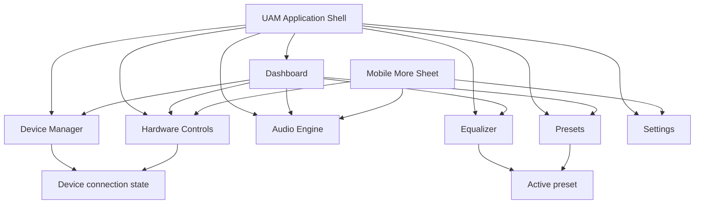

# Universe Audio Management — Phase 1 Design Specification

**Document status:** Developer handoff  
**Product:** Universe Audio Management (UAM)  
**Milestone:** Phase 1 — Foundation and UX  
**Primary implementation target:** Flutter/Dart with a Rust shared core and native platform adapters  
**Design source of truth reviewed:** Existing interactive React/Vite prototype in `src/App.tsx` and `src/index.css`  
**Last documented:** 2025

> This document records the design that currently exists. It does not extend the design or imply that prototype data is connected to real audio hardware. Items labeled **Recommendation** are implementation guidance, not implemented prototype behavior. Values labeled **Not specified / Requires developer verification** are not defined by the current source.

---

## 01 — Project Overview

### Product identity

Universe Audio Management (UAM) is a cross-platform audio management and customization product. Its vision is:

> “One Platform. Every Audio Device. Your Sound, Your Rules.”

UAM combines two related product domains:

1. **Audio processing:** equalization, preamp control, processing status, endpoint information, presets, and diagnostics.
2. **Hardware management:** discovery, connection state, device information, battery data, and device-dependent controls such as ANC, transparency, low-latency mode, multipoint, and microphone sidetone.

The unifying UX principle is that users should not need a different mental model for every audio device, while the interface must remain honest about differences in operating-system and hardware support.

### Product objectives

- Provide one coherent workspace for devices, sound shaping, engine status, and reusable presets.
- Make everyday controls approachable without hiding technical status from advanced users.
- Clearly distinguish configured, active, unavailable, unsupported, disconnected, permission-gated, and not-yet-implemented features.
- Scale from a dense desktop workspace to a deliberate touch-oriented mobile interface.
- Establish reusable visual and interaction patterns suitable for a production Flutter implementation.

### Target audience

- Everyday listeners who want quick sound customization.
- Audio enthusiasts who need precise gain and frequency controls.
- Multi-device users managing several peripherals.
- Gaming users interested in profiles and latency controls.
- Content creators and professionals reviewing endpoints and diagnostics.
- Users importing, exporting, and sharing presets.

### Supported product platforms

- Windows
- macOS
- Linux
- Android
- iOS

The prototype itself is a responsive web implementation. It demonstrates layout and behavior; it does not establish platform feature parity.

### Design philosophy

The design combines a premium dark audio-studio aesthetic with a professional hardware dashboard. It favors restrained visual effects, compact technical metadata, explicit status language, and strong workspace hierarchy over decorative spectacle.

### Core UX principles

1. **Capability truthfulness:** unsupported features never appear operational.
2. **Status before control:** device and processing state should be understood before the user acts.
3. **Progressive technical depth:** primary status is plain-language; metadata and diagnostics provide detail.
4. **Shared patterns:** cards, badges, toggles, notices, buttons, and navigation behave consistently.
5. **Adaptive—not merely scaled—layouts:** desktop and mobile use different navigation and content flow.
6. **Local confidence:** the preset import dialog explicitly states that validation is local.

---

## 02 — Design Direction and Visual Identity

### Overall style

The existing interface is a **premium dark audio studio and technical control surface**. The application uses deep navy-black backgrounds, graphite cards, cool gray text, and cyan as the dominant interaction color. Success, warning, and error colors are reserved for state communication.

### Dark interface characteristics

- The global canvas is `#080C12` with a subtle radial cyan-blue atmosphere near the upper portion.
- Surfaces are differentiated primarily through small luminance changes and `1px` borders rather than heavy elevation.
- Cards use a restrained dark diagonal gradient from approximately `rgba(19,26,36,.98)` to `rgba(14,20,29,.98)`.
- The fixed sidebar and sticky top bar use translucent backgrounds; the top bar includes an `18px` backdrop blur.
- Cyan glows are used only for brand, active status, selected navigation, and response-curve emphasis.

### Primary visual identity

The UAM brand mark is a cyan-to-blue hexagonal “U”:

- Default mark: `38 × 38px`
- Compact mark: `30 × 30px`
- Shape: CSS polygon clip path
- Fill: `linear-gradient(145deg, #22C6F8, #1967D2)`
- Glow: `0 0 26px rgba(44,191,243,.20)`

The visual language is reinforced by technical uppercase labels, compact status dots, waveform/equalizer graphics, and device-oriented iconography.

### Accent usage

Primary cyan (`#2CBFF3`) is used for:

- Primary and text actions
- Active navigation icons
- Focus outlines
- Audio curves and slider accent
- Informational statuses
- Selected preset borders
- Device and feature icon surfaces

It is not used as a broad decorative fill. Primary buttons use a cyan-to-blue gradient.

### Surface hierarchy

1. **Canvas:** `--bg`
2. **Structural background:** `--bg-2`; sidebar uses a related translucent value
3. **Primary card:** `--surface`
4. **Secondary/interactive surface:** `--surface-2`
5. **Elevated or selected control surface:** `--surface-3`
6. **Modal:** primary surface plus a stronger border and black elevation shadow

### Density and hierarchy

Desktop density is intentionally high enough for audio monitoring. Page titles and device names are large, but most metadata is `8–11px` with uppercase tracking. Cards usually expose one dominant value or action followed by compact supporting metadata.

The hierarchy generally follows:

1. Page eyebrow
2. Page title
3. Page description
4. Section/card title
5. Primary state or value
6. Supporting metadata
7. Technical labels and identifiers

### Interaction philosophy

- Interactive elements use subtle lift, color, border, or fill changes rather than large motion.
- Hardware controls are disabled or replaced by explanatory badges when not actionable.
- Navigation is persistent on desktop and task-prioritized on mobile.
- The prototype intentionally contains both functional and visual-only controls. Section 09 distinguishes them.

---

## 03 — Color System

### Core tokens

All values below are extracted from `src/index.css`.

| Token | CSS token / exact value | Usage |
|---|---|---|
| Background Primary | `--bg: #080C12` | Main application canvas |
| Background Secondary | `--bg-2: #0C1119` | Secondary structural background; token exists but is not widely referenced |
| Surface Primary | `--surface: #111720` | Cards, device selector, modal |
| Surface Secondary | `--surface-2: #151D28` | Secondary buttons and hover surfaces |
| Surface Elevated | `--surface-3: #1A2430` | Selected segments, badges, raised controls |
| Border Subtle | `--border: #24303D` | Card borders, separators, tracks |
| Border Emphasis | `--border-hi: #344354` | Hover, input, modal, and elevated borders |
| Text Primary | `--text: #F2F6FA` | Primary copy and values |
| Text Secondary | `--text-2: #96A5B5` | Descriptions and secondary copy |
| Text Disabled / Tertiary | `--text-3: #637283` | Metadata, disabled state, muted labels |
| Primary Accent | `--accent: #2CBFF3` | Focus, curves, active icons, informational state |
| Accent Dark | `--accent-2: #168BD4` | Toggle fill and primary button gradient |
| Success | `--success: #45D8A0` | Connected, healthy, available |
| Warning | `--warning: #F0B35C` | Standby, unknown, caution |
| Error | `--error: #F06E77` | Errors and destructive state |
| Information | `#2CBFF3` through `--accent` | Informational state and notices |

### Additional colors in use

| Exact value | Usage |
|---|---|
| `#22C6F8` | Brand-mark gradient start |
| `#1967D2` | Brand-mark gradient end |
| `#28BFF4` | Primary button gradient start |
| `#168BD4` | Primary button gradient end |
| `#A797F6` | “Not yet implemented” / planned capability label |
| `#FF9AA1` | Destructive button text |
| `#FFFFFF` | Toggle thumb and selected high-contrast text |
| `#000000` | Modal shadow |
| `#0A0F16`, `#0A0F15` | Core-status and segmented-control wells |
| `#0D131B` | Inset panels, selected list items, drop zone |
| `#111B25` | Mini response-curve thumbnail background |
| `#202A35` | Toggle off background |
| `#2C3744` | Equalizer vertical track |
| `#526171` | Equalizer zero line |
| `#84919E` | Toggle off thumb |

### State overlays

State surfaces use token colors at low opacity:

- Information: `rgba(44,191,243,.06–.15)`
- Success: `rgba(69,216,160,.07)`
- Warning: `rgba(240,179,92,.06–.10)`
- Error: `rgba(240,110,119,.06–.08)`
- Planned: `rgba(167,151,246,.10)`

These overlays should be preserved in Flutter using explicit alpha values rather than visually approximated opaque fills.

---

## 04 — Typography System

### Font family

The implementation imports **Inter** from Google Fonts with weights `400`, `500`, `600`, and `700`. Fallbacks are `ui-sans-serif`, `system-ui`, and `sans-serif`.

Technical identifiers and timestamps use:

```text
ui-monospace, SFMono-Regular, Menlo, monospace
```

### Typography specification

The source does not define a named type scale. The following is the actual emergent scale.

| Role | Size | Weight / treatment | Line height |
|---|---:|---|---|
| Desktop page title | `28px` | Browser-inherited bold; `letter-spacing: -.035em` | Not specified / Requires developer verification |
| Mobile page title | `24px` | Browser-inherited bold; `letter-spacing: -.035em` | Not specified / Requires developer verification |
| Large device title | `22px` desktop, `17px` mobile, `15px` ≤390px | Bold |
| Brand “UAM” | `18px` | Bold, `.08em` tracking |
| Major status/title | `17–19px` | Bold |
| Section title | `15px` | Bold |
| Card title | `13–14px` | Bold |
| Global body baseline | `14px` | `400` |
| Button label | `12px` | `600` |
| Navigation / standard compact label | `11–12px` | Mixed `500–600` |
| Description / supporting copy | `9–11px` | `400`; secondary color |
| Eyebrow | `9px` | `700`, `.18em` tracking, uppercase |
| Technical/category label | `8–9px` | `700`, `.10–.12em` tracking, uppercase |
| Badge/status label | `7–8px` | `700`, `.08–.10em` tracking, uppercase |
| Brand descriptor | `8px` | `.20em` tracking |

### Explicit line heights

Most text uses the browser default line height. Explicit values are:

- Empty-state description: `1.6`
- Permission panel copy: `1.6`
- Information-box text: `1.5`
- Filter microcopy: `1.55`
- Hardware description: `1.45`
- Preset description: `1.5`
- Mobile page description: `1.5`

### Numerical values

- Equalizer values use tabular numerals through `font-variant-numeric: tabular-nums`.
- Preamp gain uses tabular numerals.
- Device ID, data location, file extension, and diagnostic time use monospace.
- Frequency labels range from `32 Hz` through `16k`; units are visually reduced where included.

### Flutter typography mapping note

Because the prototype has many one-off compact sizes, the Flutter implementation should define semantic `TextStyle`s for eyebrow, metadata, status, technical value, and microcopy in addition to standard `TextTheme` roles. Do not globally scale all metadata to body size without checking card fit.

---

## 05 — Spacing and Layout System

### Observed spacing scale

No formal spacing tokens exist in CSS. Repeated implemented values form this practical scale:

| Step | Value | Typical usage |
|---|---:|---|
| 1 | `2–3px` | Tight metadata separation, segmented inset |
| 2 | `4–5px` | Navigation gaps, label/value gaps |
| 3 | `6–8px` | Compact control gaps and padding |
| 4 | `9–10px` | Icon/text gaps, notices, compact rows |
| 5 | `12px` | Standard compact padding and gaps |
| 6 | `14–16px` | Grid gaps, notices, card internals |
| 7 | `18–20px` | Standard card padding and section separation |
| 8 | `22–24px` | Modal padding and larger grouping |
| 9 | `28–34px` | Page-level spacing |
| 10 | `50px` | Large empty-state vertical padding |

This is a documentation of observed values, not a source-defined token scale.

### Structural dimensions

| Element | Desktop | Tablet (`≤1100px`) | Mobile (`≤760px`) |
|---|---:|---:|---:|
| Sidebar width | `238px` | `76px` | Hidden |
| Top bar height | `78px` | `78px` | `60px` |
| Main left offset | `238px` | `76px` | `0` |
| Content padding | `32px 34px 70px` | Same | `22px 15px 94px` |
| Content maximum width | `1500px` | `1500px` | Available width |
| Bottom navigation | Hidden | Hidden | `70px`, plus safe-area bottom padding |
| Default card padding | `20px` | `20px` | `20px`; `16px` at ≤390px |
| Default card radius | `14px` | `14px` | `14px` |

### Borders and radii

- Standard border: `1px solid`
- Default card radius: `14px`
- Modal radius: `16px`
- Notices and device selector: `10px`
- Common button/input/navigation radius: `7–9px`
- Badge radius: `5px`
- Toggle radius: `20px`
- Circular status dots, ring, and icon elements: `50%`

### Shadows and elevation

| Element | Shadow |
|---|---|
| Brand mark | `0 0 26px rgba(44,191,243,.20)` |
| Active sidebar indicator | `0 0 12px #2CBFF3` |
| Connected dot | `0 0 8px rgba(69,216,160,.40)` |
| Primary button | `0 8px 24px rgba(22,139,212,.18)` |
| Modal | `0 30px 100px #000` |
| Mobile more sheet | `0 -15px 50px rgba(0,0,0,.45)` |
| Headphone illustration | `drop-shadow(0 18px 20px rgba(0,0,0,.40))` |

### Grid behavior

- Dashboard: two columns, approximately `1.55fr / .65fr`, `16px` gap.
- Device Manager: flexible primary column plus `300px` permission panel, `20px` gap.
- Equalizer: flexible primary panel plus `270px` side panel, `16px` gap.
- Audio Engine: four equal columns with spanning status/path cards and `14px` gaps.
- Hardware Controls: two equal columns, `12px` gap.
- Presets: three equal columns, `14px` gap.
- Settings: `220px` local navigation plus a content column capped by layout at `750px`, `24px` gap.

At mobile width, these become vertical flows except locally scrollable settings tabs and the bottom navigation.

---

## 06 — Application Information Architecture

### Primary modules

1. Dashboard
2. Device Manager
3. Equalizer
4. Audio Engine
5. Hardware Controls
6. Presets
7. Settings

### Desktop navigation

- A fixed left sidebar contains the brand, six product modules, Settings, and UAM Core health.
- The active item uses an accent icon, cyan-tinted background gradient, and a `3px × 24px` left rail.
- Device Manager includes a green or muted connection dot.
- The sticky top bar contains a breadcrumb and selected-device selector.
- Selecting the device area navigates to Device Manager; it is not an inline device picker in the current prototype.

At widths `≤1100px`, the sidebar collapses from `238px` to `76px`; text labels and core-status copy are hidden, but icons remain.

### Mobile navigation

At `≤760px`, the desktop sidebar is removed. The bottom bar exposes:

- Home
- Devices
- EQ
- Presets
- More

“More” opens a bottom sheet linking to Audio Engine, Hardware Controls, and Settings. The mobile top bar retains the compact UAM brand and device icon.



---

## 07 — Page-by-Page Design Specification

### Dashboard

**1. Purpose**  
Provide an immediate control-center view of device connection, audio configuration, active tuning, hardware capabilities, recent presets, and system health.

**2. Layout structure**  
A two-column desktop grid becomes a deliberate vertical mobile sequence. Cards include selected device, processing overview, quick EQ, hardware shortcuts, recent presets, and system health.

**3. Components**

- Welcome header and refresh button
- Disconnected warning notice
- Selected Device card with CSS headphone illustration
- Audio Processing card with ring visualization
- Quick Equalizer card
- Hardware shortcut rows
- Recently Used preset rows
- System Health diagnostic card

**4. Content hierarchy**

- “Control Center” eyebrow and “Good evening, Alex”
- Device identity and connection status
- Processing state
- Active preset and ten-band overview
- Capability shortcuts
- Recent content and health

**5. Interactions**

- “Find devices” and “View device” navigate to Device Manager.
- “Connect demo device” switches prototype connection state to connected.
- “Open audio engine,” “Fine tune,” “All controls,” and “Preset library” navigate to their respective pages.
- Refresh, hardware shortcut toggles, recent preset rows, and “Run diagnostics” are visual-only in the prototype.

**6. States**

- Connected and disconnected selected-device states
- Active DSP visual state
- Supported, unsupported, and disconnected hardware rows
- All-systems-normal health state

**7. Responsive behavior**

Mobile order is device, EQ, processing, hardware, presets, diagnostics. The desktop refresh action is hidden. Device graphics and typography reduce in size; device metadata stacks.

**8. Developer notes**

- “Alex,” `82%`, Bluetooth 5.3, `48 kHz / 24-bit`, `8.2 ms`, “Strong connection,” DSP Running, and System Output are **sample/demo values**.
- The Dashboard says DSP “Running,” while Audio Engine states “Ready, not processing” and configuration-only mode. Production must derive both surfaces from one authoritative engine state and eliminate this contradiction.
- Recent rows must not look selectable unless selection behavior is implemented.

### Device Manager

**1. Purpose**  
Discover devices, manage connection state, inspect metadata, and communicate capability confidence.

**2. Layout structure**  
The primary column contains connected-device detail and available devices. A sticky `300px` permission panel sits on the right; mobile stacks it below.

**3. Components**

- Scan action
- Connected device detail card
- Metadata grid
- Capability chips
- Empty connected-device state
- Available-device rows
- Scanning state
- Bluetooth permission panel

**4. Content hierarchy**

Connection status and device identity precede battery, transport, codec, ID, and capability information.

**5. Interactions**

- Scan shows a spinner and “Searching nearby…” for `1100ms`, then returns to the static results.
- Disconnect changes shared prototype state and updates other pages.
- Connect for Auralux restores shared connection state.
- Living Room Speaker “Connect” and “Manage permissions” are visual-only.

**6. States**

- Connected
- Disconnected/empty
- Scanning/loading
- Supported device
- Unknown capabilities
- Bluetooth permission enabled

Permission denied, no devices found, and explicit unsupported-device full-page states are **not designed in the implemented prototype**.

**7. Responsive behavior**

The layout stacks; metadata becomes a two-column grid; action rows wrap, with buttons moved beneath device metadata.

**8. Developer notes**

- Auralux Studio Pro, `82%`, 24-hour estimate, codecs, device ID, and capability list are demo data.
- Discovery must use native platform permission and adapter state rather than a timer.
- Unknown capability is different from unsupported and must remain a separate domain value.

### Equalizer

**1. Purpose**  
Offer precise but approachable frequency shaping through a graphic ten-band EQ.

**2. Layout structure**  
Desktop uses a large EQ workspace plus a `270px` side rail for output/preamp and filter model. Mobile stacks the side rail below.

**3. Components**

- Active preset selector
- Reset and Save As Preset actions
- EQ bypass toggle
- Frequency response graph
- Ten vertical sliders
- Per-band gain values and frequency labels
- Preamp range control and two-channel meter
- Headroom information
- Filter-model list

**4. Content hierarchy**

Preset and bypass state lead, followed by response visualization, band controls, output/preamp, and filter-type explanation.

**5. Interactions**

- Preset selector changes the active preset and all ten gain values.
- Three preset profiles are wired: Studio Reference, Deep Focus, and Vocal Clarity.
- Each band accepts `-12 dB` to `+12 dB` in `.5 dB` steps.
- Bypass disables sliders and visually desaturates the graph and controls.
- Reset restores the default gain array.
- Save As Preset and preamp behavior are visual-only.

**6. States**

- Active processing
- Bypassed/disabled controls
- Three active preset configurations
- Safe-headroom informational state

No clipping/error state is implemented.

**7. Responsive behavior**

Graph height reduces from `210px` to `150px`. The EQ remains ten bands in one row; gain labels are hidden at `≤390px`. This preserves density but requires touch validation.

**8. Developer notes**

- Implement sliders with accessible values and keyboard increments.
- The SVG response graph is static and does not recalculate from current sliders. Production should either calculate the curve or clearly treat it as decorative.
- Preamp displays `−1.5 dB`, but its slider is uncontrolled and not connected to state.
- Peaking/low-shelf/high-shelf rows are informational; only Peaking appears active. Q control is explicitly unavailable in this graphic-preset mode.

### Audio Engine

**1. Purpose**  
Explain engine readiness, processing scope, endpoint, backend, Rust core health, signal path, and diagnostics without falsely claiming verified processing.

**2. Layout structure**  
A four-column grid includes two spanning top cards, four metric cards, and a full-width diagnostic log. Mobile stacks all cards.

**3. Components**

- Configuration-only notice
- Engine status card
- Signal path
- Processing Scope, Selected Endpoint, Audio Backend, and DSP Core cards
- Diagnostic log
- Export Report action

**4. Content hierarchy**

The configuration-only disclaimer appears first. “Ready, not processing” is the primary state, with “Standby” status. Technical cards and logs follow.

**5. Interactions**

Export Report is visual-only. There are no live polling, retry, or error actions.

**6. States**

- Configuration active
- Ready, not processing
- Standby
- Signal output “Not verified”
- Healthy core
- Diagnostic OK and Notice entries

Explicit engine failure and unavailable layouts are **not implemented**.

**7. Responsive behavior**

Four columns reduce to two at `≤1100px`, then a single vertical flow at `≤760px`. Signal-path nodes become vertical.

**8. Developer notes**

- Current backend, version, endpoint, sample rate, channel count, and timestamps are demo content.
- “CoreAudio adapter” implies macOS sample context; it must not appear on other platforms unless reported.
- Configuration and verified processing must be represented as separate domain fields.

### Hardware Controls

**1. Purpose**  
Expose device-specific controls while making capability limitations explicit.

**2. Layout structure**  
A selected-device chip sits in the header. Two-column control cards become one column on mobile. A capability-transparency notice closes the page.

**3. Components**

- ANC toggle
- Transparency mode toggle
- Gaming/low-latency toggle
- Adaptive noise control badge
- Touch-control permission action
- Multipoint not-yet-implemented badge
- Microphone sidetone unsupported state
- Disconnected notice

**4. Content hierarchy**

Verified device identity and connection state precede available controls. Each card then presents feature name, explanation, control or capability badge, and reason/action where relevant.

**5. Interactions**

- ANC and low-latency toggle local prototype state.
- Disconnecting the shared device replaces all controls with disconnected badges.
- “Review permission” is visual-only.
- Transparency displays an inverse ANC value, but its current handler does not produce a complete mutually exclusive ANC/transparency transition. Treat this as a prototype limitation.

**6. States**

- Available
- Unsupported
- Permission required
- Not yet implemented
- Disconnected

Loading and per-control error states are not visually implemented.

**7. Responsive behavior**

Cards become single-column; headings stack their label/control, preserving room for long capability badges.

**8. Developer notes**

- Capability state must come from the device/platform adapter.
- Unsupported, unknown, permission required, disconnected, planned, loading, and error must be separate enum values.
- A feature card must render a toggle only when state is available and the device is connected.

### Presets

**1. Purpose**  
Browse local sound profiles, preview/select them, and begin portable preset import.

**2. Layout structure**  
A toolbar contains search, library tabs, and category filtering. A three-column card grid becomes two columns at `≤1100px` and one column on mobile.

**3. Components**

- Search field
- All/Favorites/Created by Me tabs
- Category action
- Six preset cards
- Category and author metadata
- Mini response-curve preview
- Favorite, preview/active, export, and overflow actions
- Import dialog

**4. Content hierarchy**

Preset category and curve preview lead to name, description, author, band count, and actions.

**5. Interactions**

- Preview sets the shared active preset name.
- Import opens a modal; backdrop, close, and Cancel dismiss it.
- Continue is disabled.
- Search, tabs, category, favorite, export, overflow, Create Preset, Choose File, validation, and save are visual-only.

**6. States**

- Active preset
- Inactive/previewable preset
- Hovered card
- Import step 1 of 5
- Disabled Continue action

Import validation, compatibility warning, file preview, confirmation, and completion states are not designed beyond the step indicator and copy.

**7. Responsive behavior**

Toolbar wraps, search becomes full width, tabs scroll horizontally, and cards become one column.

**8. Developer notes**

- Preset authors and content are sample data.
- Selecting a preset from this page changes only the name, not the EQ gain array; the Equalizer selector changes both. Production requires one preset model and one activation flow.
- `.uam-preset.json` is the documented portable format.

### Settings

**1. Purpose**  
Organize app preferences, appearance, platform behavior, version data, and reset actions.

**2. Layout structure**  
A `220px` settings category list sits beside a content column. Mobile renders categories as a horizontal scroll strip.

**3. Components**

- Category navigation
- Launch at Startup toggle
- Language selector
- Close Behavior selector
- Theme segment
- Reduced Motion toggle
- About/version card
- Reset Preferences danger zone

**4. Content hierarchy**

General settings appear first, then Appearance, About UAM, and reset.

**5. Interactions**

- Launch at Startup changes local prototype state.
- Select elements can change visually through native browser behavior but are not persisted.
- Category navigation, theme segment, reduced motion, and reset are visual-only.

**6. States**

- General category selected
- Dark theme selected
- Launch at Startup enabled
- Up-to-date application status
- Destructive reset action

Confirmation dialog, save/error feedback, and reset completion are not implemented.

**7. Responsive behavior**

Category navigation becomes horizontally scrollable; setting rows retain side-by-side control placement; About becomes one column at narrow width.

**8. Developer notes**

- Version numbers, data path, Preview channel, and update state are demo values.
- Desktop-only preferences should be hidden or explained on mobile.
- The required category list exists, but only General, Appearance, About, and Reset content is displayed. Audio, Devices, Permissions, Preset Management, and Storage detail pages are not designed.

---

## 08 — Component Library

### Inventory

| Component | Purpose | Dimensions / visual properties | Variants and states | Responsive behavior |
|---|---|---|---|---|
| Application Sidebar | Primary desktop navigation | `238px` wide; fixed; `1px` right border | Active, inactive, hover; connection dot | Collapses to `76px` at 1100; hidden at 760 |
| Top Bar | Breadcrumb and device context | `78px`; sticky; translucent + `18px` blur | Connected/offline selector | `60px`; breadcrumb and device copy hidden |
| Bottom Navigation | Primary mobile tasks | `70px` plus safe area; five destinations | Active cyan indicator | Mobile only |
| More Sheet | Secondary mobile destinations | `8px` side insets; `16px` radius | Open/closed | Mobile only |
| Device Selector | Shows current device | Compact bordered row; `30px` icon tile | Connected, offline | Icon-only mobile |
| Card | Shared content surface | `20px` padding; `14px` radius; `1px` border | Default, selected, disabled-card | `16px` padding ≤390 |
| Status Indicator | Compact semantic status | `6px` glowing dot; `8px` uppercase label | Success, warning, error, info, muted | No structural change |
| Capability Badge | Non-operational state label | `4px 7px`; `5px` radius; `7px` uppercase | Unsupported, permission, planned, disconnected | Wraps within card |
| Button | Primary action | Minimum `36px` high; `0 14px`; `8px` radius | Primary, secondary, subtle, destructive, disabled, hover, focus | Header icon-only variant on mobile |
| Icon Button | Compact icon action | `32 × 32px`; `8px` radius | Default, hover, focus | Same |
| Toggle | Binary control | `37 × 21px`; `15px` thumb | On, off, disabled, focus | Same |
| Notice | Page-level status message | `14px 16px`; `10px` radius | Warning, info, error, neutral | Action may hide on mobile |
| Device Card | Device identity and detail | Responsive; illustration/detail variants | Connected, disconnected, available, scanning | Wraps/stacks |
| Empty State | Explain absence | `50px 20px` or compact `25px` | Device disconnected/no selection | Same |
| Loading State | Discovery feedback | `24px` spinner; centered scan card | Scanning | Same |
| Equalizer Band | Frequency gain input | Vertical track; range `-12…+12`, step `.5` | Editable, disabled/bypassed | Labels reduce/hide narrowly |
| Response Graph | Audio response overview | `210px` desktop SVG | Active, bypass opacity/grayscale | `150px` mobile |
| Processing Ring | DSP summary | `130 × 130px` | Active visual only | Same |
| Preset Card | Preset metadata and actions | Three-column card; mini SVG graph | Active, inactive, hover | 3 → 2 → 1 columns |
| Hardware Control Card | Capability-aware feature | Minimum `128px`; icon, copy, control/badge | Available, unsupported, permission, planned, disconnected | One column mobile |
| Setting Row | Label, description, control | Minimum `65px`; top separator | Toggle/select/segment | `78px` min mobile |
| Import Dialog | Start preset import | Max `500px`; `16px` radius; strong shadow | Open, closed, disabled continuation | `18px` padding mobile |

### Components not present

- Tooltip: **Not designed / not implemented.**
- Confirmation dialog: **Not designed / not implemented.**
- Toast/snackbar feedback: **Not designed / not implemented.**
- Skeleton loading: **Not designed / not implemented.**
- Per-control error component: **Not designed / not implemented.**

### Icon system

Icons are custom inline SVGs using one coherent line style:

- `24 × 24` view box
- `fill: none`
- `stroke: currentColor`
- `stroke-width: 1.8`
- Rounded line caps and joins

The prototype contains icons for navigation, devices, Bluetooth, battery, controls, status, files, favorites, permissions, microphone, and common actions.

---

## 09 — Interaction and Behavior Specification

| Interaction | Trigger | Actual prototype behavior | Feedback/state transition | Error behavior |
|---|---|---|---|---|
| Navigate modules | Sidebar, bottom bar, More sheet, dashboard links | Changes the rendered page and scrolls to top smoothly | Active navigation state updates | None |
| Open mobile More | Tap More | Toggles bottom sheet | More remains active while open or on secondary module | None |
| Device selector | Tap top-bar selector | Navigates to Device Manager | Page/nav state updates | None |
| Scan devices | Tap Scan | Shows loading state for `1100ms` | Spinner and searching text, then static results | None; simulated |
| Disconnect device | Tap Disconnect | Shared `connected=false` | Dashboard, Device Manager, Hardware Controls, and top bar update | None |
| Connect demo device | Tap Connect or dashboard demo action | Shared `connected=true` | Connected content appears | None |
| Change EQ preset | Select preset in Equalizer | Updates name and ten gains | Sliders move to predefined arrays | None |
| Adjust EQ band | Drag range input | Updates one value in local/shared array | dB label and thumb update | None |
| Bypass EQ | Toggle bypass | Disables sliders | Graph/controls desaturate and fade | None |
| Reset EQ | Tap Reset | Restores default array | Sliders return to default | None |
| Toggle ANC/latency | Tap available toggle | Updates local Hardware page state | Thumb and fill update | None |
| Preview preset | Tap Preview | Changes active preset name | Card becomes active | Gains do not update; prototype inconsistency |
| Open import | Tap Import | Opens modal | Backdrop and step 1 shown | None |
| Close import | Backdrop, close, or Cancel | Closes modal | Returns to Presets | None |
| Launch at startup | Tap toggle | Updates local Settings state | Toggle changes | No persistence |

### Visual-only controls

The following look interactive but have no implemented product behavior: Dashboard Refresh, system diagnostics, hardware shortcuts, recent preset rows, permission management, unknown-device connect, preamp persistence, Save As Preset, Export Report, Review Permission, preset search/filter/favorite/export/overflow/create, file selection/import steps, settings categories, theme, reduced motion, reset, and several secondary selectors.

Production must either wire these controls or render them as non-interactive information. Decorative controls must not retain misleading tap/hover behavior.

---

## 10 — State Management and UI States

### Implemented prototype state

| State | Current source |
|---|---|
| Current page | Shared `page` state |
| Device connected | Shared `connected` boolean |
| Active preset name | Shared `preset` string |
| EQ gains | Shared array of ten numbers |
| Import dialog | Shared `importOpen` boolean |
| Mobile More sheet | Shared `moreOpen` boolean |
| Scan loading | Local Device Manager boolean |
| EQ bypass | Local Equalizer boolean |
| ANC / latency | Local Hardware Controls booleans |
| Launch at startup | Local Settings boolean |

### Required reusable state categories

| Category | Intended presentation in current language | Implemented? |
|---|---|---|
| Initial | Default content and selected values | Yes |
| Loading | Spinner and progress copy | Device scan only |
| Success | Green dot/badge/status | Yes |
| Empty | Centered icon, title, description, action | Yes |
| Error | Red notice/destructive language | Disconnected notice style only; no operational error flow |
| Connected | Green status + enabled verified controls | Yes |
| Disconnected | Offline status, notice, disabled capability badges | Yes |
| Available | Interactive toggle/action | Yes |
| Unsupported | Muted badge plus reason; no control | Yes |
| Permission Required | Amber badge plus review action | Yes |
| Not Implemented | Violet badge; no control | Yes |
| Unknown Capability | Warning status, no capability claim | Device list only |

### Capability-aware model

**Recommendation:** use a sealed type or enum such as:

```dart
enum CapabilityAvailability {
  available,
  unsupported,
  permissionRequired,
  disconnected,
  unavailableOnPlatform,
  notImplemented,
  unknown,
  loading,
  error,
}
```

This is a recommended Flutter representation, not an existing repository architecture. An `available` capability should separately carry its value and mutation/loading status. Never infer support from a previously displayed value.

---

## 11 — Responsive Design Specification

### Actual breakpoints

| Range | Implemented behavior |
|---|---|
| `>1100px` | Full desktop sidebar and multi-column workspaces |
| `≤1100px` | Icon-only `76px` sidebar; dashboard ratios tighten; preset grid 2 columns; engine grid 2 columns |
| `≤760px` | Mobile top bar and bottom navigation; sidebar hidden; major grids stack |
| `≤390px` | Reduced page/card padding, smaller device title/status/frequency labels, hidden EQ dB labels |

No explicit minimum supported width is defined.

### Desktop

- Persistent sidebar and sticky contextual top bar.
- Maximum content width `1500px`.
- Dense multi-column data surfaces.
- Hover behavior and precise sliders are available.

### Tablet

- Sidebar becomes icon-only.
- Labels are hidden; current implementation does not add tooltips, creating a discoverability gap.
- Three-column presets reduce to two.
- Audio Engine reduces to two columns.

### Mobile

- Task-prioritized bottom navigation and More sheet.
- Content has `94px` bottom padding to clear navigation.
- Safe-area bottom padding uses `env(safe-area-inset-bottom)`.
- Grids stack, toolbar wraps, and tab/category rows scroll horizontally.
- Modal fits viewport width through `width: min(500px, 100%)`.

### Equalizer on touch

The prototype retains ten narrow vertical native range inputs. It does not define minimum drag-target width or alternate fine-adjustment UI.

**Recommendation:** validate each band at 360px physical width. Provide tap-to-select plus enlarged drag handling or a focused band editor if accurate adjustment is difficult. Preserve the visible ten-band overview.

### Overflow prevention

Implemented safeguards include `minmax(0, 1fr)`, `min-width: 0`, wrapping device rows, horizontally scrolling tabs/settings categories, flexible modal width, and mobile bottom padding. Long localized strings and large accessibility text remain unverified.

---

## 12 — Accessibility Guidelines

### Implemented features

- Buttons and form controls use semantic HTML elements.
- Toggle buttons use `role="switch"` and `aria-checked`.
- Toggle and EQ controls have accessible labels.
- Modal declares `role="dialog"`, `aria-modal="true"`, and an accessible name.
- Current page is announced through an `aria-live="polite"` visually hidden region.
- Keyboard focus uses a `2px` cyan outline with `2px` offset.
- Disabled controls use the native `disabled` attribute where implemented.
- State is communicated through text as well as color in most badges/notices.
- Range controls support native keyboard behavior.

### Gaps in the current prototype

- Modal focus is not trapped and focus is not restored on close.
- Escape-key dialog dismissal is not implemented.
- Tablet icon-only sidebar has no implemented tooltip or visible label.
- Several icon buttons rely on context and lack explicit accessible names.
- SVG response graphs do not have textual alternatives.
- Extremely small `7–9px` metadata may be difficult for low-vision users.
- Touch targets such as `32px` icon buttons and `37 × 21px` toggles are below a recommended `44 × 44px` hit area.
- Color contrast has not been formally measured in source.
- Smooth scroll does not consult reduced-motion preference.
- Settings Reduced Motion is not wired.
- Native range-slider visuals and contrast vary by platform.

### Implementation requirements

- Preserve visible focus on every actionable control.
- Give every icon action a semantic label and tooltip on desktop.
- Use at least a `44 × 44dp` hit region on touch platforms without necessarily enlarging the visible glyph.
- Announce connection, scan, import, processing, and error changes.
- Ensure disabled capability cards remain readable and explain why action is unavailable.
- Do not use disabled styling alone for unsupported state; retain explicit status text.
- Test at 200% text scaling and with screen readers on all target platforms.
- **Recommendation:** target WCAG 2.2 AA contrast and interaction requirements.

---

## 13 — Motion and Micro-interactions

### Actual motion

| Element | Actual value |
|---|---|
| Navigation/button/control transition | Mostly `0.2s` |
| Standard button transition | `0.18s` |
| Button hover | `translateY(-1px)` plus brightness increase |
| Preset card hover | `translateY(-2px)` and stronger border |
| Toggle thumb | `0.2s`; translates `16px` |
| Loading spinner | `.8s linear infinite` rotation |
| Page navigation scroll | Browser `smooth` behavior |
| Dialog/sheet enter/exit animation | Not specified / not implemented |
| Easing | Browser default for transitions unless linear spinner |

### Status and slider feedback

- Active statuses use subtle color glow.
- Sliders update continuously through input change.
- Bypass applies immediate opacity and grayscale.
- Device scan switches immediately to a spinner and returns after a simulated duration.

### Recommendations

These values are not present in the prototype and should be validated before adoption:

- Respect platform reduce-motion settings.
- Prefer `150–220ms` for simple control transitions.
- Add a short opacity/scale transition for modal and sheet only if it does not delay operation.
- Avoid animating diagnostic values in ways that imply live data when no live stream exists.

---

## 14 — Flutter Implementation Mapping

### Design tokens

Map existing values centrally rather than duplicating them in widgets.

| Design concern | Flutter mapping |
|---|---|
| Core colors | `ColorScheme.dark` plus a UAM `ThemeExtension` |
| State colors | Custom semantic extension: success, warning, error, info, planned |
| Surface levels | `scaffoldBackgroundColor`, card color, and custom elevated surface tokens |
| Typography | `TextTheme` plus custom eyebrow, metadata, status, technical styles |
| Spacing | Immutable constants or extension using the observed spacing values |
| Radius | Central constants for `5, 7, 8, 9, 10, 14, 16, 20` |
| Borders | Shared `BorderSide(width: 1, color: ...)` |
| Buttons | `ElevatedButtonTheme`, `OutlinedButtonTheme`, `TextButtonTheme`, icon-button style |
| Inputs | `InputDecorationTheme`, slider theme, switch theme |
| Motion | Central duration constants respecting reduce-motion |

Illustrative token organization:

```dart
abstract final class UamSpacing {
  static const xs = 4.0;
  static const sm = 8.0;
  static const md = 12.0;
  static const lg = 16.0;
  static const xl = 20.0;
  static const page = 34.0;
}

abstract final class UamRadii {
  static const control = 8.0;
  static const notice = 10.0;
  static const card = 14.0;
  static const modal = 16.0;
}
```

This code is an implementation recommendation derived from actual values; these class names do not currently exist.

### Suggested widget architecture

| Design element | Suggested Flutter widget responsibility |
|---|---|
| Application shell | Adaptive navigation, page body, selected-device context |
| Sidebar | Desktop destinations, active state, core status |
| Top bar | Breadcrumb/page context and selected-device summary |
| Mobile navigation | Four primary destinations and More sheet |
| `UamCard` | Shared gradient, border, radius, padding |
| `UamStatus` | Semantic dot and label |
| `CapabilityBadge` | Capability enum to visual treatment |
| Device cards | Identity, metadata, capability list, connection actions |
| Equalizer | Graph, ten band controls, preset selector, bypass, preamp |
| Hardware control tile | Capability-aware control or explanatory state |
| Preset card | Metadata, graph preview, active/preview actions |
| Notice banner | Info/warning/error/neutral page feedback |
| Import dialog | Multi-step import state and validation results |

### Feature mapping

```text
app/flutter/lib/
├── app/                         # shell, routing, themes, responsive navigation
├── design_system/               # tokens and shared UAM widgets
├── features/
│   ├── dashboard/
│   ├── device_manager/
│   ├── equalizer/
│   ├── audio_engine/
│   ├── hardware_controls/
│   ├── presets/
│   └── settings/
└── platform/                    # contracts to Rust/native adapters, if consistent with repository
```

These paths are the requested handoff mapping, not a claim that the directories already exist.

### Page-to-feature responsibilities

| Feature | Presentation | State/business boundary |
|---|---|---|
| Dashboard | Aggregated summary widgets | Read-only projection from device, engine, EQ, and diagnostics states |
| Device Manager | Discovery list/detail and permissions | Native discovery and connection adapter |
| Equalizer | Graph, bands, preamp, bypass, presets | DSP configuration model and Rust command boundary |
| Audio Engine | Scope, endpoint, backend, diagnostics | Verified runtime telemetry distinct from desired configuration |
| Hardware Controls | Capability-aware tiles | Device capability descriptor and native command results |
| Presets | Library/cards/import | Local persistence, JSON validation, compatibility |
| Settings | Categories and controls | Platform-aware preference service |

### Implementation principles

- Keep presentation separate from DSP, Bluetooth, permissions, and persistence logic.
- Use one authoritative device state and one authoritative active-preset model.
- Represent desired configuration separately from verified runtime application.
- Reuse card, status, notice, button, badge, and spacing primitives.
- Use adaptive widget composition rather than shrinking desktop widgets.
- Do not hardcode sample device values into production widgets.
- Preserve platform-specific availability and copy.
- Follow the existing repository architecture if it differs; this document does not mandate a state-management package or routing library.

---

## 15 — Technical and Product Constraints

### Runtime truth

The current prototype demonstrates UX, not real hardware or audio behavior. Flutter presentation must consume verified state from Rust and platform adapters.

The production model must distinguish:

- Desired/configured DSP values
- Configuration accepted by the core
- Audio stream actually being processed
- Processing scope (app-only, endpoint, system-wide, unavailable)
- Endpoint selected versus endpoint active
- Hardware feature advertised versus validated
- Permission missing versus platform unsupported
- Device disconnected versus capability unknown

### Platform limits

- Do not imply unrestricted system-wide EQ on iOS.
- Do not assume every Android device exposes system audio processing.
- Do not assume Bluetooth battery, codec, ANC, gestures, or multipoint metadata is available.
- CoreAudio is macOS-specific; backend labels must come from runtime.
- Native adapters can have different permission and discovery models.

### Prototype demonstration data

The following values are illustrative and must not be treated as verified:

| Surface | Demo values |
|---|---|
| Device | Auralux Studio Pro, Living Room Speaker |
| Battery | `82%`, approximately `24h` |
| Transport | Bluetooth 5.3, Strong |
| Codec | AAC, SBC |
| Device ID | `UAM-AU-9C21` |
| Engine | DSP Running, System Output, `48 kHz / 24-bit`, `8.2 ms` |
| Backend | CoreAudio adapter `v0.8.2` |
| Core | UAM Rust Core `v0.9.0` |
| App | `1.0.0-alpha.6`, Preview channel |
| Data path | `~/Library/UAM` |
| Capabilities | ANC, transparency, low latency, and all support labels |
| Diagnostics | Static timestamps and messages |

### Known semantic contradiction

Dashboard presents “DSP Running” and Audio Processing “Active,” while Audio Engine explicitly presents “Configuration-only mode,” “Ready, not processing,” and “Not verified.” The Audio Engine wording is the safer product rule. Production must remove the Dashboard claim unless runtime confirms processing.

### Data and workflow limits

- Preset persistence and `.uam-preset.json` validation are not implemented.
- No real settings persistence exists.
- No real device permission, discovery, connection, or capability query exists.
- No real diagnostics export exists.
- No actual audio graph calculation exists.
- The prototype is not evidence of production performance or audio correctness.

---

## 16 — Developer Handoff Checklist

### Documentation coverage

- [x] Design tokens extracted.
- [x] Typography documented.
- [x] Color system documented.
- [x] Component inventory completed.
- [x] Navigation documented.
- [x] Dashboard documented.
- [x] Device Manager documented.
- [x] Equalizer documented.
- [x] Audio Engine documented.
- [x] Hardware Controls documented.
- [x] Presets documented.
- [x] Settings documented.
- [x] Responsive behavior documented.
- [x] Accessibility documented.
- [x] Interactions documented.
- [x] Flutter mapping documented.
- [x] Technical limitations documented.

### OpenCode CLI implementation checklist

- [ ] Establish centralized UAM colors, type styles, spacing, radii, borders, shadows, and durations.
- [ ] Implement adaptive shell at the documented breakpoints or equivalent Flutter width classes.
- [ ] Implement route/deep-link behavior for all seven modules.
- [ ] Create a single device-state source shared by shell and feature pages.
- [ ] Create a processing-state model that separates configured from verified active processing.
- [ ] Implement capability enum and ensure unavailable features never render as active controls.
- [ ] Replace all demo values with typed runtime fields and explicit unknown/null handling.
- [ ] Implement one active-preset model shared by Presets, Equalizer, and Dashboard.
- [ ] Implement real EQ curve calculation or label the preview as illustrative.
- [ ] Validate ten-band touch interaction at 360px and with text scaling.
- [ ] Implement permission-denied, no-devices, device-error, engine-error, and per-control loading/error states.
- [ ] Complete preset import steps: file selection, validation, preview, compatibility warning, confirmation, local save.
- [ ] Add confirmation and feedback for destructive/reset actions.
- [ ] Add semantics, tooltips, focus management, announcements, and minimum touch targets.
- [ ] Wire reduced motion to platform accessibility settings.
- [ ] Verify Windows, macOS, Linux, Android, and iOS differences with native adapters.
- [ ] Add widget, golden, accessibility, and responsive tests.

---

## 17 — Final Design Quality Review

### Audit summary

| Area | Assessment |
|---|---|
| Consistency | Strong shared dark surfaces, borders, controls, icons, and status patterns |
| Visual hierarchy | Clear page/section/value hierarchy; some metadata is very small |
| Color | Consistent and restrained; semantic colors are used appropriately |
| Typography | Cohesive Inter system, but no formal named type tokens and many compact one-off sizes |
| Spacing | Visually consistent around a practical 4–20px rhythm; not tokenized in source |
| Component reuse | Strong conceptual reuse; React implementation is partly reusable primitives and partly page-specific markup |
| Navigation | Clear desktop and mobile structures; tablet icon-only mode lacks tooltips |
| Responsive behavior | Substantial adaptation exists at 1100, 760, and 390px |
| Accessibility | Focus and semantics are partially implemented; target sizes, modal focus, text size, and contrast need validation |
| Implementation feasibility | High for Flutter if tokens and shared state models are established first |

### Unresolved issues and design gaps

1. Dashboard processing claims conflict with Audio Engine configuration-only status.
2. Preset selection behavior differs between Equalizer and Presets.
3. Many controls look interactive but are visual-only.
4. Transparency and ANC behavior is not a complete mutually exclusive interaction.
5. Permission-denied, no-results, device error, engine failure, per-control loading/error, and confirmation states are missing.
6. Preset import is designed only for its first step.
7. Several Settings categories have navigation labels but no designed detail content.
8. Tooltip design is absent, especially problematic for the icon-only tablet sidebar.
9. No formal contrast audit, text-scaling test, or minimum touch-target enforcement is documented in source.
10. The static response graph does not reflect slider values.
11. Mobile ten-band precision needs usability testing.
12. Modal focus trapping, Escape dismissal, and focus restoration are absent.
13. Localization behavior and long-string overflow are unverified.
14. Component-level error messaging and toast/snackbar feedback are not designed.

### Final handoff position

The current UAM prototype establishes a coherent and implementation-feasible Phase 1 foundation. Its strongest product characteristic is explicit capability language: available features use controls, while unsupported, permission-gated, planned, and disconnected features use transparent status treatment. The Flutter implementation should preserve that rule while replacing every demonstration value and simulated interaction with typed, runtime-verified state.
