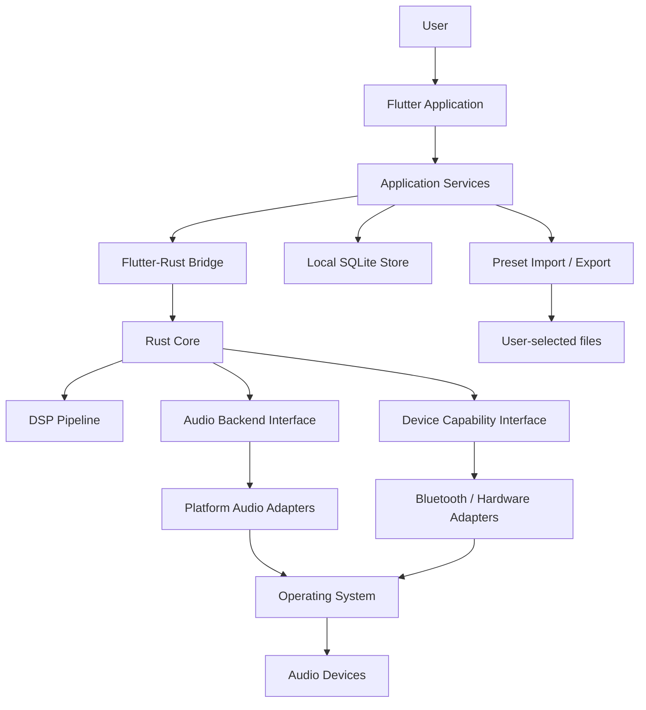
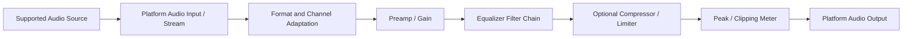
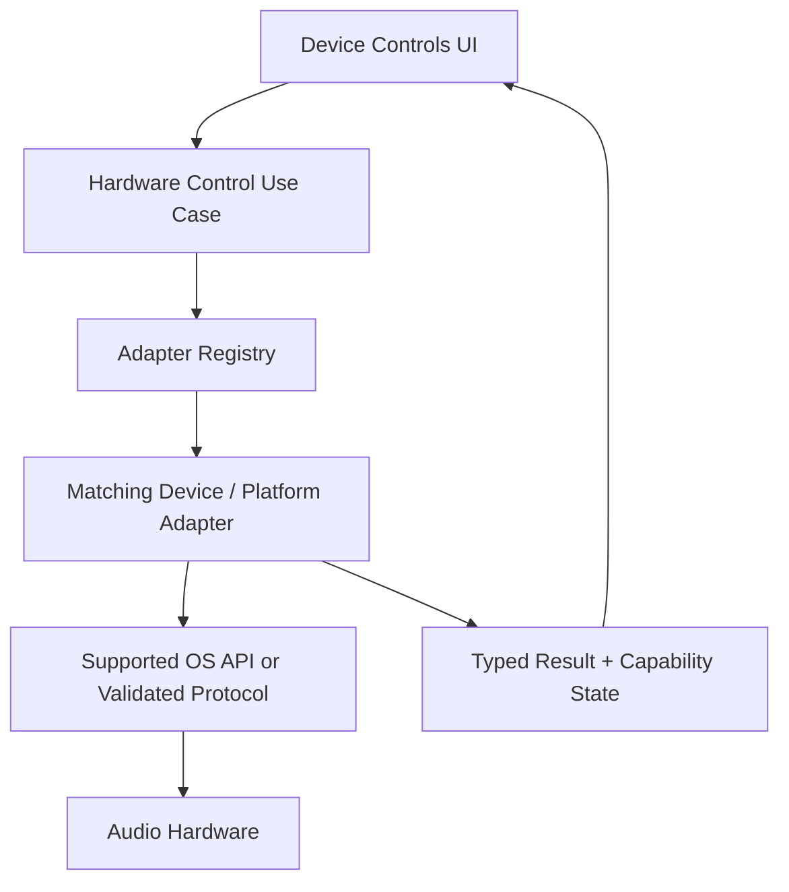
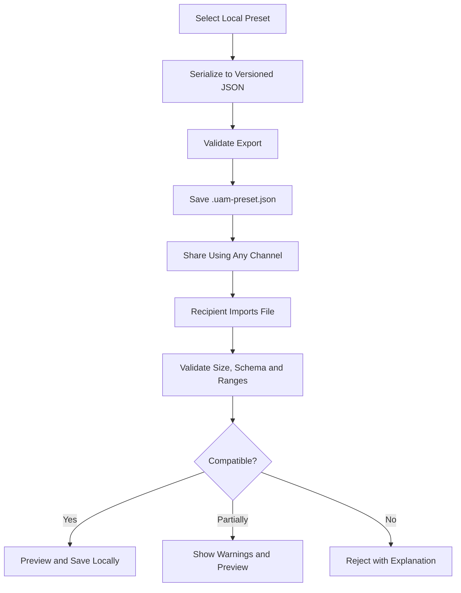

# UAM System Architecture
## Universe Audio Management

**Version:** Draft v1.0  
**Architecture style:** Modular monolith with platform adapters and a shared Rust core  
**Primary UI:** Flutter  
**Core engine:** Rust  
**Storage:** SQLite locally; JSON for portable exchange

---

## 1. Architecture Goals

- Keep UI, domain logic, DSP, persistence, and native integrations separated.
- Reuse audio-processing logic across platforms.
- Isolate operating-system APIs behind adapters.
- Make feature availability explicit and testable.
- Support offline operation and portable preset sharing.
- Avoid coupling the Rust core to Flutter widget or UI state.
- Keep real-time audio execution predictable.

## 2. High-Level System Context



## 3. Architectural Layers

### 3.1 Presentation Layer — Flutter

Responsibilities:
- Navigation, pages, dialogs, and reusable UI components.
- EQ controls and preset editor.
- Device and capability presentation.
- Import/export user flows.
- Permission explanations and platform-specific notices.
- Rendering state received from application services.

Rules:
- Do not implement DSP algorithms in Dart.
- Do not call native OS APIs directly from UI widgets.
- Do not assume a feature exists because a device is connected.
- UI state should be derived from application/domain state.

### 3.2 Application Layer — Dart

Responsibilities:
- Coordinate user actions and use cases.
- Manage application state.
- Call repositories and Rust services.
- Orchestrate import/export flows.
- Translate domain results into UI-friendly states.

Example use cases:
- `CreatePreset`
- `UpdatePreset`
- `ExportPreset`
- `ImportPreset`
- `ListAudioDevices`
- `GetDeviceCapabilities`
- `ApplyEqualizerConfiguration`
- `SetProcessingEnabled`

### 3.3 Interoperability Layer

Responsibilities:
- Expose a stable boundary between Flutter/Dart and Rust.
- Convert data to explicit, versioned DTOs.
- Map Rust errors to typed application errors.
- Avoid passing platform handles or raw pointers into UI state.

Recommended approach:
- Evaluate `flutter_rust_bridge` for generated bindings and structured types.
- Keep the bridge API small and coarse-grained.
- Use asynchronous calls for setup, file validation, and control operations.
- Use a dedicated native audio callback path for real-time samples; do not shuttle individual audio frames through Dart FFI.

### 3.4 Rust Core Layer

Suggested crates:
- `uam_domain`: domain types and validation.
- `uam_dsp`: filters, EQ chain, gain, dynamics, meters.
- `uam_audio`: audio graph and backend abstraction.
- `uam_device`: normalized device/capability models.
- `uam_preset`: preset schema, parsing, validation, migrations.
- `uam_platform`: platform adapter interfaces and shared orchestration.
- `uam_ffi`: narrow bridge-facing API.

Rust core must not depend on Flutter widgets or application-specific UI concepts.

### 3.5 Platform Adapter Layer

Each platform implements the interfaces it can support.

| Platform | Audio integration candidates | Device/Bluetooth candidates |
|---|---|---|
| Windows | WASAPI / Windows audio APIs | Windows Bluetooth APIs; BLE APIs where supported |
| macOS | Core Audio | CoreBluetooth |
| Linux | PipeWire; PulseAudio compatibility | BlueZ |
| Android | Android audio APIs / AudioEffect where applicable | Android Bluetooth and BLE APIs |
| iOS | AVAudioEngine / AVAudioSession | CoreBluetooth within platform restrictions |

These are integration candidates, not a guarantee that every feature is available. Validate API access, permissions, sandboxing, and distribution constraints.

## 4. Core Domain Models

### AudioDevice
Suggested fields:
- `id`: application-level identifier.
- `platformId`: optional platform-provided identifier.
- `displayName`.
- `deviceType`: output, input, headset, speaker, unknown.
- `transport`: bluetooth, usb, built_in, analog, unknown.
- `connectionState`: connected, disconnected, unknown.
- `capabilities`: capability set.
- `metadata`: safe, non-secret optional values.

Do not assume Bluetooth addresses are stable or universally visible. Avoid using them as the sole identity key.

### DeviceCapabilities
A capability should include:
- `featureId`.
- `supported`.
- `availability`: available, unavailable, permission_required, unsupported, unknown.
- `controlMode`: read_only, read_write, not_applicable.
- `source`: OS API, standard profile, vendor adapter, inferred.
- `reason`: optional human-readable explanation.
- `adapterId` and adapter version where relevant.

### EqualizerConfiguration
Suggested fields:
- schema/model version.
- preamp in dB.
- filter list.
- enabled/bypass state.
- sample-rate/channel assumptions only where required.

### Preset
Suggested fields:
- stable local ID.
- name, description, tags, author label.
- creation/update timestamps.
- audio configuration.
- schema version.
- compatibility metadata.

## 5. Audio Processing Architecture



### DSP design requirements
- Use sample-rate-aware filter coefficient calculations.
- Support validated sample formats and channel layouts.
- Avoid allocations and blocking locks in real-time callbacks.
- Separate parameter preparation from audio-thread application.
- Use lock-free or bounded message passing for parameter updates where appropriate.
- Define clipping behavior and safe gain defaults.
- Provide bypass that does not cause abrupt or unsafe transitions.
- Test for denormals, NaN, infinity, and invalid parameter values.
- Benchmark latency and CPU use on reference hardware.

### Audio scope
The application must report one of the following:
- `app_owned_stream`: UAM processes audio generated or played by UAM.
- `selected_stream`: UAM processes a supported selected stream.
- `system_output`: UAM processes system output through a supported integration.
- `configuration_only`: UAM edits settings but is not currently connected to an audio processing path.

Never label configuration-only behavior as active system-wide processing.

## 6. Hardware Control Architecture



Rules:
- Prefer documented operating-system APIs and published standards.
- Vendor-specific adapters must be isolated and independently testable.
- Never send arbitrary undocumented Bluetooth commands by default.
- Hardware controls should be capability-gated.
- A successful Bluetooth pairing does not prove access to ANC or touch-control APIs.
- Include timeouts, cancellation, permission checks, and safe failure behavior.
- Do not store pairing keys or OS secrets in the UAM database.

## 7. Local Persistence Architecture

### Recommended storage split

**SQLite**
- Presets and EQ configurations.
- User-created profiles.
- Application settings.
- Device aliases and non-sensitive metadata.
- Schema/migration metadata.

**JSON interchange files**
- Individual shareable presets.
- Optional complete user-configuration backups.
- Versioned metadata and compatibility information.

**No cloud requirement**
- UAM must work offline.
- Sharing can happen through user-selected file destinations or external services.
- The app should not silently upload files.

### Suggested SQLite tables

| Table | Purpose |
|---|---|
| `presets` | Preset identity and metadata |
| `preset_filters` | Ordered EQ filter parameters |
| `profiles` | User-defined listening profiles |
| `profile_presets` | Optional mapping between profiles and presets |
| `device_aliases` | User-defined device names and safe metadata |
| `app_settings` | Application preferences |
| `schema_migrations` | Applied database migrations |

Use foreign keys, transactions, indexes for common lookups, and migrations. Avoid storing volatile connection state as durable truth; query the platform adapter at runtime.

### Preset sharing flow



### Example table sketch

```sql
CREATE TABLE presets (
    id TEXT PRIMARY KEY,
    name TEXT NOT NULL,
    description TEXT,
    author_label TEXT,
    schema_version INTEGER NOT NULL,
    is_favorite INTEGER NOT NULL DEFAULT 0,
    created_at TEXT NOT NULL,
    updated_at TEXT NOT NULL
);

CREATE TABLE preset_filters (
    id TEXT PRIMARY KEY,
    preset_id TEXT NOT NULL REFERENCES presets(id) ON DELETE CASCADE,
    position INTEGER NOT NULL,
    filter_type TEXT NOT NULL,
    frequency_hz REAL NOT NULL,
    gain_db REAL NOT NULL,
    q_factor REAL NOT NULL,
    UNIQUE (preset_id, position)
);

CREATE TABLE app_settings (
    key TEXT PRIMARY KEY,
    value_json TEXT NOT NULL,
    updated_at TEXT NOT NULL
);
```

This is a starting schema, not a final migration. Validate all numeric ranges in application/domain logic as well as at the import boundary.

## 8. Preset Interchange Contract

Recommended format:
- Extension: `.uam-preset.json`
- Top-level format identifier: `uam-preset`
- Required `schemaVersion`.
- Metadata and audio configuration.
- Explicit units, such as Hz and dB.
- Device-independent by default.
- No executable content, scripts, credentials, or raw vendor commands.

Import validation should include:
- File size limit.
- JSON parse and schema validation.
- Supported schema version.
- Allowed filter types.
- Frequency, gain, and Q-factor bounds.
- Maximum number of filters and tags.
- String length limits.
- Duplicate/unknown field policy.
- Safe migration or rejection behavior.

## 9. Error Handling

Use typed error categories:
- `permission_denied`
- `platform_unsupported`
- `device_unavailable`
- `adapter_not_found`
- `connection_lost`
- `invalid_configuration`
- `incompatible_schema`
- `audio_backend_error`
- `processing_error`
- `storage_error`
- `operation_cancelled`

Errors should include safe diagnostic context, but never secrets or sensitive device identifiers.

## 10. Threading and Concurrency

- Flutter UI runs on the main isolate.
- Application orchestration uses asynchronous Dart APIs.
- DSP runs in the native audio processing context.
- Audio callback work must be bounded and real-time safe.
- Device discovery/control runs on asynchronous platform-specific workers.
- SQLite operations run outside the audio callback.
- Never perform disk I/O, network I/O, logging-heavy work, or blocking locks in the audio callback.

## 11. Security and Privacy Boundaries

- Local data is private to the OS user account by default.
- Use OS-provided secure storage only if future credentials/tokens are required.
- Do not persist Bluetooth pairing credentials.
- Treat imported preset files as untrusted input.
- Do not load executable plugins from preset files.
- Keep vendor protocol adapters allowlisted and reviewed.
- Optional online catalogue must be opt-in and have a clear data policy.

## 12. Observability and Diagnostics

Provide an opt-in diagnostics view containing:
- UAM version.
- OS version and architecture.
- Audio backend name/version.
- Selected audio endpoint type.
- Audio sample rate and channel layout when available.
- DSP status and processing scope.
- Adapter capability status.
- Non-sensitive error codes.

Do not record audio samples or private file paths by default.

## 13. Testing Strategy

- Rust unit tests for DSP, domain models, and preset validation.
- Property/fuzz tests for imported JSON.
- Dart unit tests for use cases and state management.
- Integration tests for Flutter-Rust bridge.
- Platform adapter tests on actual operating systems.
- Audio loopback/measurement tests where supported.
- Manual hardware matrix tests for vendor-specific controls.
- Regression tests for device removal, sleep/wake, permission denial, and audio-session interruption.

## 14. Architecture Decision Records

Record important decisions under `docs/adr/`.

Suggested initial ADRs:
- ADR-001: Flutter for shared UI.
- ADR-002: Rust for DSP and shared core.
- ADR-003: Flutter–Rust interoperability (narrow C ABI and Dart FFI).
- ADR-004: Local-first data and portable preset interchange.
- ADR-005: Capability-based hardware control.
- ADR-006: Windows-first audio integration.
- ADR-007: Real-time audio thread safety requirements (deferred to the phase
  that introduces a live audio backend).

Phase 0 records ADR-001 through ADR-006 under `docs/adr/`.

## 15. Key Architectural Risks

- Platform audio APIs do not provide identical routing capabilities.
- Mobile operating systems restrict global audio processing.
- Bluetooth standard profiles do not expose every vendor feature.
- Hardware metadata may be unavailable or privacy-restricted.
- A generic abstraction can become leaky if platform differences are hidden.

Mitigation: expose capability and processing-scope models explicitly rather than forcing every platform into a false common denominator.

## 16. Phase 1 implementation notes

Phase 1 implements the presentation and application foundation only. It follows
the boundaries above but deliberately leaves the audio, device, persistence, and
network layers unimplemented.

- **State management:** `UamAppController` (a `ChangeNotifier`) is exposed through
  `UamAppScope` (`InheritedNotifier`). This adds no third-party state dependency.
  Feature controllers own engine, device, equalizer, and preset-library state.
- **App rebuild boundary:** the `MaterialApp` rebuilds only for appearance
  preference changes; feature updates propagate through the inherited notifier.
  This keeps navigation stable while configuration state changes.
- **Routing:** named routes with one responsive `UamShell` around every module.
- **Design system:** typed tokens and a `ThemeExtension` provide dark, light, and
  system appearance. The dark palette comes from `design_uam.md`; the light
  palette is a documented derivative.
- **Bridge:** `EngineInfoGateway`, `RustApi`, and ABI `1` are unchanged. The
  reported scope remains `configuration_only`.
- **Presets:** `.uam-preset.json` schema v1 is parsed by a strict Dart mirror and
  exercised against repository fixtures. There is no FFI preset-validation
  symbol yet, so Rust validation is not claimed.
- **Not implemented:** SQLite tables from §7, the audio pipeline from §5, real
  device discovery from §6, and any network service. Their interfaces remain
  future work.

See `docs/PHASE_1_REPORT.md` for the test evidence and explicit limitations.

## 17. Phase 2 implementation notes

Phase 2.1–2.2 add the DSP configuration foundation. Phase 2.3A–2.3D adds the
preset adapter, peak meter, limiter, pipeline, and numerical-safety regression
coverage; Phase 2.6 adds the benchmark suite. These milestones still do **not**
attach an audio backend or a Flutter DSP controller.

- **Audio format model.** `uam_domain::SampleFormat` describes the *external
  boundary* format a future backend delivers or expects (`F32`/`F64`).
  `INTERNAL_PROCESSING_FORMAT` is always `F64`: the processing kernel is `f64`
  only, and no native `f32` kernel is claimed. `AudioConfig::new` is unchanged
  and defaults to `F64`; `AudioConfig::with_format` records a boundary format.
- **DSP configuration DTO.** `uam_dsp::DspConfig` carries the audio
  configuration, preamp, ordered EQ bands, bypass state, and optional
  `LimiterConfig` metadata. It is validated by one `validate()` against the
  documented ranges in `uam_dsp::validation`.
- **Control-thread reconfiguration.** `Equalizer::from_config` builds a chain
  from a DTO; `Equalizer::apply_config` replaces parameters in place. A
  sample-rate or channel change returns `ReconfigurationRequired`; a rejected
  update leaves the active chain untouched.
- **Limiter.** `uam_dsp::Limiter` is a real processor: feed-forward,
  zero-look-ahead, channel-linked, instantaneous attack with one-pole release.
  The output sample peak is bounded to `LimiterConfig::ceiling_db` for every
  finite input. It is a separate component composed by `DspPipeline`, so
  `Equalizer` stays limiter-agnostic. It is **not** true-peak and has no
  look-ahead (`latency_samples() == 0`).
- **Metering.** `uam_dsp::PeakMeter` measures sample peak per channel and
  overall, counts clipped and non-finite samples, and always reports finite
  dBFS (floored at `-200.0`). It is sample peak only, never true peak.
- **Pipeline (2.3C).** `uam_dsp::DspPipeline` runs input meter -> preamp + EQ ->
  pre-limiter meter -> limiter -> output meter and returns a `PipelineReport`
  (input, pre-limiter clipping, gain reduction, output). `process_interleaved`
  is allocation- and lock-free.
- **Preset adapter (2.3A).** `uam_preset::adapter::Preset::to_dsp_config` bridges
  the portable schema to a validated `DspConfig`, reusing `DspConfig::new` as the
  single numeric authority (no second set of bounds).
- **Real-time hand-off.** `process_interleaved` remains allocation- and
  lock-free. The parameter hand-off model (immutable prepared state, bounded
  single-owner transfer, applied at a block boundary) is recorded in
  `docs/adr/ADR-007`; implementation is deferred to the backend milestone.
  `uam_dsp` and `uam_domain` remain `#![forbid(unsafe_code)]`.
- **Not implemented:** parameter transport, FFI DSP symbols, Flutter DSP
  controller, WASAPI backend. See `docs/PHASE_2_3_IMPLEMENTATION_REPORT.md`.

See `docs/PHASE_2_IMPLEMENTATION_REPORT.md` and
`docs/PHASE_2_3_IMPLEMENTATION_REPORT.md` for evidence.

## 18. Android platform and Rust FFI packaging

The Android application uses the same narrow C ABI (`uam_ffi`) as desktop.
`uam_ffi` remains a `cdylib`; its ABI is version `1` and exports only
`uam_abi_version`, `uam_get_engine_info`, and `uam_string_free`. Returned JSON
is allocated by Rust and released exactly once by Dart through
`uam_string_free`; no pointer is retained after the FFI call and no audio
callback API crosses Dart FFI.

### Build and packaging path

```text
Rust uam_ffi
  -- cargo + NDK clang, aarch64-linux-android --> libuam_ffi.so
  -- scripts/build/build_android_rust.ps1 -->
app/flutter/android/app/src/main/jniLibs/arm64-v8a/libuam_ffi.so
  -- Android Gradle packaging --> APK lib/arm64-v8a/libuam_ffi.so
  -- Android dynamic linker --> Dart DynamicLibrary.open('libuam_ffi.so')
```

`RustLibraryLocator` detects Android and returns the bare SONAME
`libuam_ffi.so`. It does not use desktop relative paths and does not use
`DynamicLibrary.process()`: a packaged library is not guaranteed to be loaded
into the process-global symbol table before the FFI bridge needs it.

The supported required ABI is `arm64-v8a`; the build script can also build
`armeabi-v7a` and `x86_64` after their Rust targets are installed. Generated
native libraries are ignored by Git and are built locally or in CI.

Android support in this phase is **FFI and application packaging only**. The
reported processing scope stays `configuration_only`. It does not provide
system-wide audio processing, audio capture, Bluetooth controls, or an Android
real-time audio backend. See `docs/ANDROID_SETUP.md` and
`docs/ANDROID_BUILD_REPORT.md` for toolchain setup and validation evidence.
